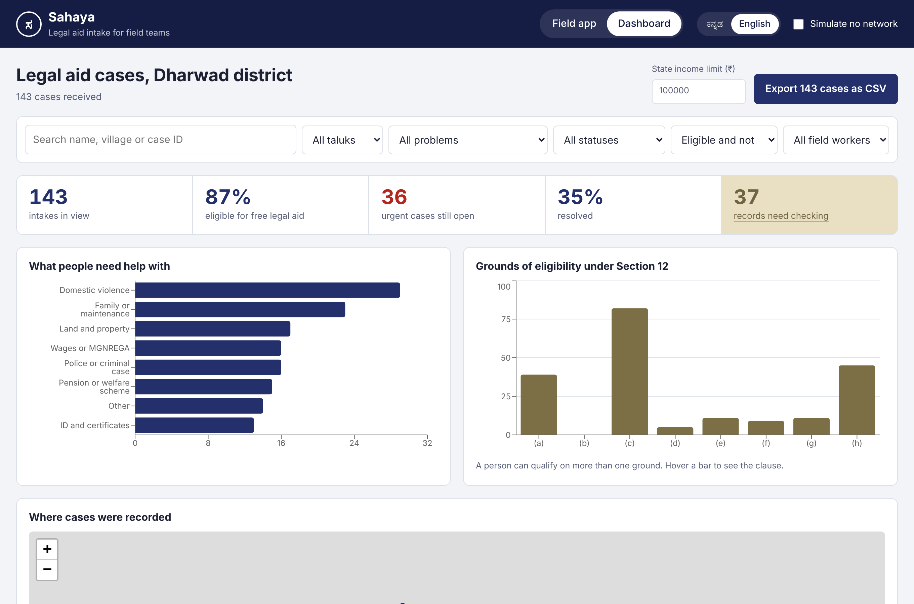
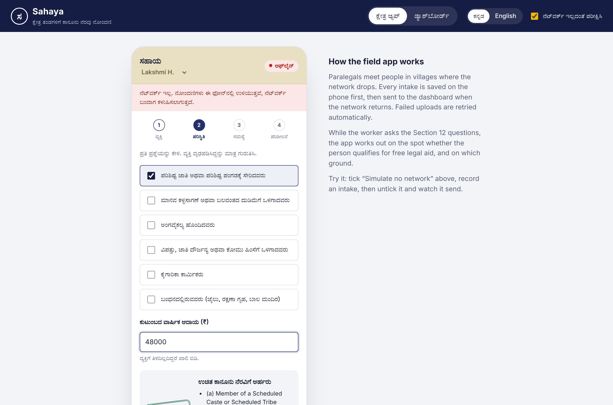
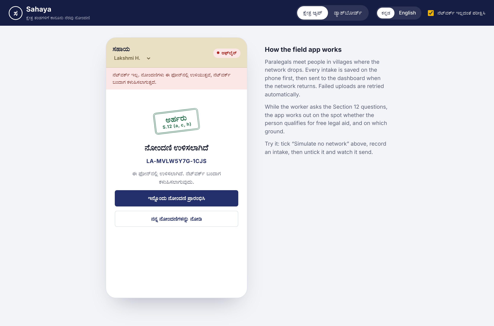
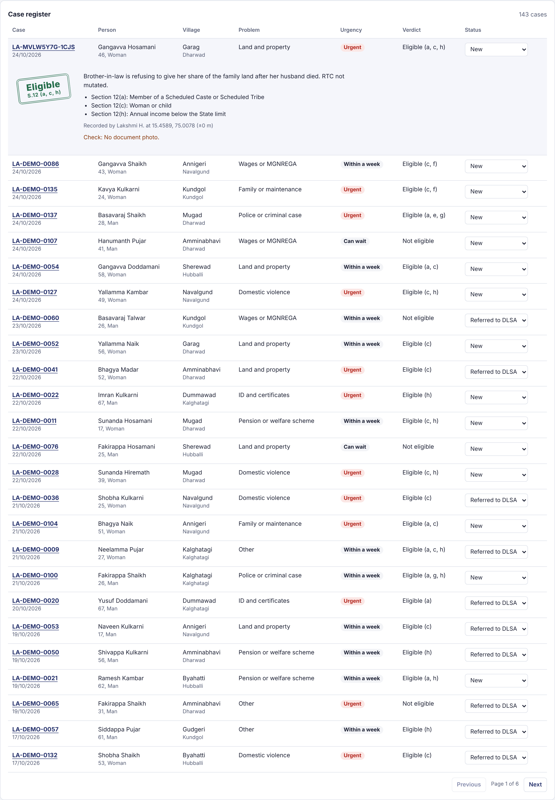

# Sahaya: offline-first legal aid intake for NGO field teams

Sahaya (ಸಹಾಯ, "help") is a field app and manager dashboard for NGOs that run legal aid camps in rural areas.

Paralegals meet people in villages where mobile network is weak. Today most of this intake is done on paper registers and later typed into Excel, so cases get lost, eligibility is worked out by hand, and coordinators cannot see what is happening across the district until weeks later.

Sahaya replaces that register with:

- a **field app** in Kannada and English that works without network,
- an **eligibility engine** that tells the paralegal on the spot whether the person qualifies for free legal aid under Section 12 of the Legal Services Authorities Act, 1987, and on which ground,
- a **manager dashboard** with charts, a case map, data quality checks, case status tracking and CSV export for DLSA and donor reporting.

**Live demo:** _add your GitHub Pages link here_



| Live eligibility check | Saved offline | Case register |
|---|---|---|
|  |  |  |

## Try it in two minutes

1. Open the live demo. The field app opens in Kannada. Switch to English at the top if you prefer.
2. Tick **Simulate no network**, then record a new intake. It is saved on the device and marked "waiting to send".
3. Untick **Simulate no network**. The intake uploads automatically. (The mock server fails 15% of uploads on purpose, so you may see it retry.)
4. Open **Dashboard** and click **Add sample data** to load 140 sample cases from Dharwad district.
5. Change the **State income limit**. Every eligibility verdict on the dashboard is recalculated.
6. Click **records need checking** to see only cases with missing GPS, missing consent, impossible ages or likely duplicates.

## Features

**Field app**
- Four-step intake form (person, situation, problem, verification) with validation at each step
- Live free legal aid eligibility verdict while the Section 12 questions are asked
- GPS capture with accuracy, and document photo capture compressed on the phone to save storage and data
- Consent checkbox that is required before saving
- Offline-first storage in IndexedDB, with an upload queue, batching, failure tracking and automatic retry
- Kannada and English interface
- Installable as a Progressive Web App and loads without network after the first visit

**Manager dashboard**
- Filters by taluk, problem type, status, eligibility, field worker and free-text search
- Headline figures: intakes, share eligible, urgent cases still open, share resolved, records needing checks
- Charts for problem types, Section 12 grounds and intakes per week
- Map of where cases were recorded, with urgent open cases highlighted
- Per-worker summary to spot training needs (for example, one worker often missing GPS)
- Case register with status updates (new, referred to DLSA, in progress, resolved) and expandable case details
- CSV export of whatever is filtered, opening correctly in Excel with Kannada text

## The eligibility engine

`src/lib/eligibility.js` is a pure function that applies Section 12 of the Legal Services Authorities Act, 1987. A person qualifies if any one clause applies.

| Clause | Ground |
|---|---|
| 12(a) | Member of a Scheduled Caste or Scheduled Tribe |
| 12(b) | Victim of trafficking or begar |
| 12(c) | Woman or child |
| 12(d) | Person with disability |
| 12(e) | Victim of mass disaster, ethnic violence, caste atrocity, flood, drought, earthquake or industrial disaster |
| 12(f) | Industrial workman |
| 12(g) | In custody, including protective home, juvenile home or psychiatric hospital |
| 12(h) | Annual income below the limit set by the State |

The income limit differs by State and changes over time, so it is a setting rather than a hard-coded number. The default (₹1,00,000) follows the Karnataka figure published by Nyaaya and should be checked against the current State notification before real use.

If income is not recorded the engine does not assume it is zero. It returns a warning instead, so a missing answer never silently makes someone eligible.

## How it is built

```
src/
  lib/
    eligibility.js   Section 12 rules engine (pure function, unit tested)
    sync.js          Offline upload queue with batching and retry (unit tested)
    quality.js       Data quality checks for the dashboard (unit tested)
    csv.js           CSV export with escaping and Excel-friendly encoding (unit tested)
    db.js            IndexedDB storage on the device, and a mock REST API
    i18n.js          Kannada and English strings
    demoData.js      Seeded sample data for Dharwad district
  components/
    FieldApp.jsx     Field worker screens
    IntakeForm.jsx   Multi-step intake form
    Dashboard.jsx    Manager dashboard
    CaseMap.jsx      Leaflet map
    Stamp.jsx        Eligibility verdict badge
```

- **React 19 + Vite.** The dashboard is loaded only when it is opened, so the field app download stays around 80 KB gzipped for low-end phones.
- **IndexedDB** (through `idb-keyval`) for device storage, because records carry photos and localStorage is capped at about 5 MB.
- **Mock REST API.** `db.js` exposes `upsertRecords`, `listRecords` and `updateStatus`, which are the same shapes a real backend (Node.js, Firebase or a SQL database) would serve. The server keeps ownership of case status, so a re-sync from a field phone never overwrites a manager's update.
- **Dependency injection in the sync engine.** `syncPending` receives the device store and API as arguments, so the tests run against simple in-memory fakes.
- **Recharts** for charts, **Leaflet** with OpenStreetMap for the map, **vite-plugin-pwa** for offline caching.
- **Vitest** for tests: 22 tests across eligibility rules, sync behaviour, data quality checks and CSV export.

## Run it locally

```bash
npm install
npm run dev      # start at http://localhost:5173
npm test         # run the unit tests
npm run build    # production build into /docs for GitHub Pages
```

## What I would build next

- A real backend (Node.js or Firebase) with authentication and per-NGO data separation
- Conflict handling when two workers record the same person while offline
- Referral letters to the District Legal Services Authority generated from a case
- Follow-up reminders for cases that have stayed open too long
- A Flutter version of the field app for better camera, GPS and background sync on Android
- Review of all Kannada strings by native-speaking field staff

## Note on data

All names and cases in the sample data are invented. Village coordinates are approximate and used only for the demo map.
